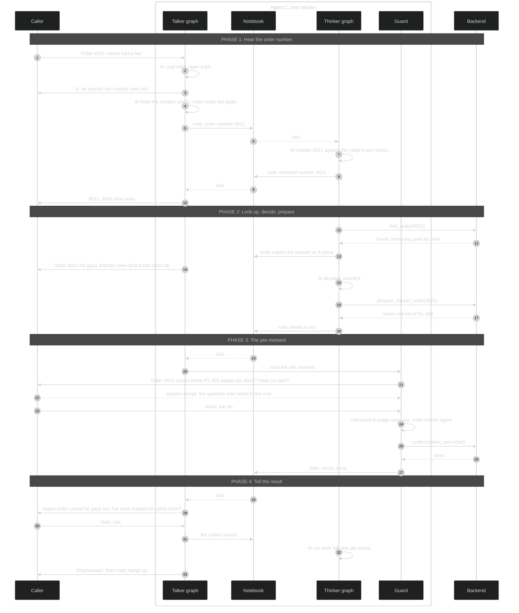
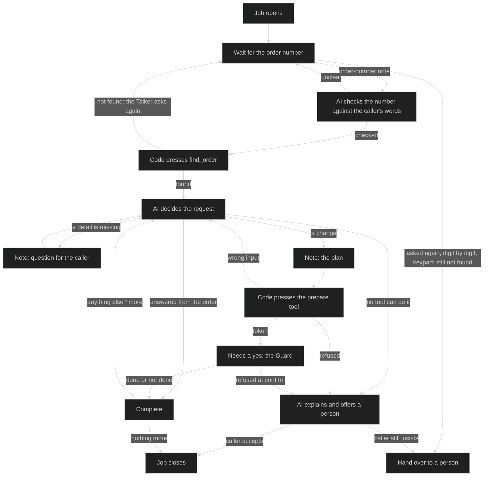
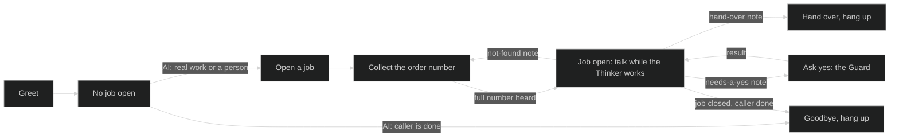
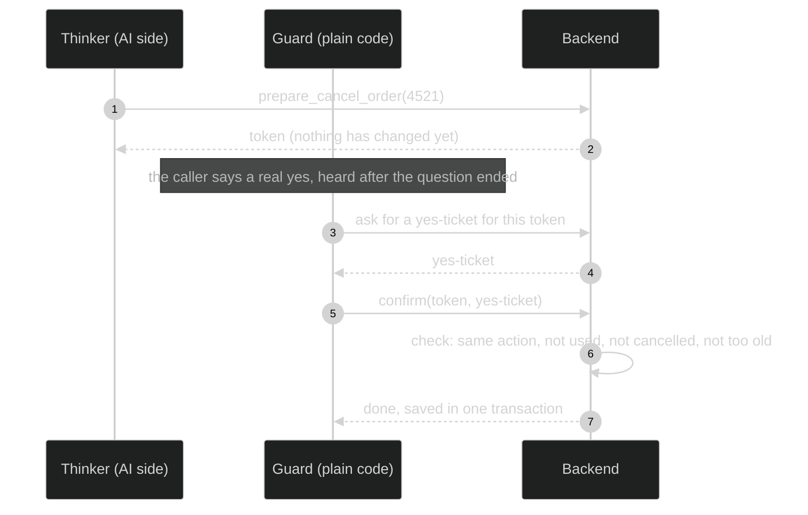

# Hearken

A phone support agent that speaks Hinglish, and a test lab that measures it.

A caller rings a food delivery helpline and says, in Hindi and English mixed: "Order 4521 cancel karna hai". The agent has to hear the order number right over a noisy phone line, look the order up, ask "cancel kar doon? Haan ya nahi?", and only then cancel it and send the money back. It must keep talking while it works, stop at once when the caller says "ruko" (wait), and never move money on a "haan" that wasn't a real yes.

Hearken builds three agents for this job and measures them in the same lab, call for call, so the numbers show which design is safer and faster.

(The code folder is still called `pakka`, the project's first working name.)

## Results so far

The same 15 practice calls, played by a pretend caller with real voices, background noise and planned interruptions. Every call is scored from the database (what really changed) and from the call recording.

| | Agent A | Agent C |
|---|---|---|
| Design | one AI does everything | a Talker and a Thinker, as two graphs |
| Calls counted | 15 of 15 | 13 of 15 |
| Task success | 27% (4 of 15) | 31% (4 of 13) |
| Harmful actions | 8 | 6 |
| Calls with made-up numbers | 3 | 1 |
| Reply delay, median | 3.44 s | **1.78 s** |
| Reply delay, slowest 10% | 7.10 s | **4.06 s** |
| Silence while a tool runs, median | 0.32 s | 0.17 s |
| Stops on "ruko" | 1 of 1 | 1 of 1 |
| Wrong stops on "haan" | 4 of 5 | 3 of 7 |

What this shows:
- **Agent C answers about twice as fast.** The Talker replies at once while the Thinker works in the background, instead of one AI doing both in turn.
- **Agent C caused fewer harmful actions and made up fewer numbers.** In Agent C code, not the AI, writes every number the caller hears.
- **Success is still low for both.** Agent C's run found real bugs (listed under "What the lab found"), and they are fixed. A clean rerun with the fixes is the next step.
- Two of Agent C's 15 calls didn't run: the pretend caller's daily AI budget ran out.

Agent A: run 7, 15 Nov 2026. Agent C: run 2, 17 Nov 2026 (some fixes landed during that run).

## The three agents

All three hear with the same speech-to-text, speak with the same voice, use the same backend tools and start with the same greeting. Only the design differs.

| | How it works | What it tests |
|---|---|---|
| **Agent A** | One AI (Gemini Flash) hears the caller, calls the tools and speaks. A Pipecat pipeline. | The common way to build a voice agent. The baseline. |
| **Agent B** | One speech-to-speech AI (Gemini Live). It hears sound and speaks sound directly. | Whether a single end-to-end model is enough. Built, not yet measured in the lab. |
| **Agent C** | A Talker that talks and a Thinker that works, joined by a notebook. Both are state graphs (LangGraph). | Whether splitting talking from thinking makes the agent faster and safer. |

## Agent C in detail

### The idea

A single AI that must both talk and think does one at a time: while it looks up an order, the caller hears silence; while it talks, nothing gets done. Agent C splits the two:

```
                 caller's words                     notes (found, needs a yes, done...)
   Caller  <------------------->  Talker graph  <------------------------------>  Thinker graph
                                  (one per call)          Notebook               (one per job)
                                        |                                              |
                                        | yes-question                                 | lookups and
                                        v                                              v changes
                                      Guard  ------------------ confirm ------------> Backend
```

- The **Talker** does all the talking: it greets, collects the order number, says what the Thinker found, and keeps the caller company while work goes on.
- The **Thinker** does all the thinking: which request it is, what is missing, which tool to use, what a refusal means. It never talks to the caller. It writes notes, and the Talker says them.
- The **notebook** is the only link between them: a list of notes with a bell that rings on each new one. Neither graph calls the other.
- The **Guard** is plain code that owns the moment of "yes". Only it can confirm a change.

### One call, end to end



### The Thinker graph

One graph runs per job, from its first step until the job closes. In each step the AI may think and decide, but only among that step's own exits. Code checks the exit, presses every tool and copies every backend answer into the notebook.



### The Talker graph

One graph runs per call. It waits at the step it reached between turns and never starts over.



### What the AI decides and what code does

The rule behind the design: **the AI understands, code acts.** A prompt rule can be skipped by the AI; a code rule can't. Every time the lab caught the AI breaking a prompt rule, the rule moved into code.

| The AI decides | Code does |
|---|---|
| Does this turn need real work? Does it hold a number? | Opens the job, starts the Thinker graph |
| Which number words the caller said | Turns them into digits and checks they were said in order |
| Which request it is, which tool, what is missing | Presses every tool, with the checked order number |
| What a refusal means, in plain words | Copies every backend answer into the notebook, as it came |
| Is "haan, lekin..." a yes? (one word: yes, no, stop, unclear, other) | Takes the yes only after the question was heard to the end, then confirms |
| What to say in a free reply | Fills every number and amount; replaces a line with a number nobody gave |

Rules that live in code because the AI broke them as prompt rules:
- A change the backend refused is never tried again with the same inputs.
- A refund names the item; code fills its price from the order. The AI never writes an amount.
- After one explanation, a caller who still insists is handed over once.
- A change is never confirmed without a yes-ticket from the Guard.
- The robot never speaks over the caller.

### Why the backend can't be fooled

An AI can't approve its own actions. Every risky action has two steps:



The yes-ticket door is only in plain code. It is never a tool, so no AI can reach it. If the caller says "ruko" while the confirm is on its way, the ticket is cancelled before the save.

## The test lab

The numbers above come from a lab built to be fair and hard to fool.

```
  Pretend caller                                         Robot (Agent A, B or C)
  ears, brain (Groq), voice                 wire          |
  noise, timed lines ("ruko"   <----------------------->  | tools (MCP)
  while the robot asks)          8 kHz audio, WebSocket   v
          |                                            Backend: a fresh database copy per call
          v
  Scorer: what changed in the database, harms, made-up numbers, delays, cut-offs
```

- **15 practice tasks** with hard moments: the rider picks the order up while the robot asks "cancel kar doon?", the caller says "haan haan" while listening, the backend loses a reply, the caller corrects a number. A separate set of exam tasks stays unseen until the final run.
- **The pretend caller** has real voices (Smallest.ai), background noise (traffic, kitchen, crowd) and a director that plays lines at an exact moment of the call.
- **The scorer** compares the database before and after each call, so it knows what really happened, not what the robot said.
- **A health check** proves the lab itself before any run: planted mistakes must be caught, a perfect robot must pass every task, and no call may see another call's changes.

## Numbers that back the design

| What | Result |
|---|---|
| Automated tests | 1356 passing |
| Lab health check | every light green: tasks, scorer, clock, no leaks, caller timing |
| Interruptions the pretend caller lands at the exact moment | 5 of 5 |
| Speech-to-text chosen by test (76 robot-voice clips) | Sarvam 68 right, Deepgram 58 |
| Number finder: when it says a number, it is right | 98% (309 of 316 cases), usually in 0.27 s |
| "haan" vs "ruko" model, on a voice it never heard | 0.91 (1 is perfect, 0.5 is guessing) |
| LangGraph's own time per graph step | 0.3 ms |
| 20 calls at once on one laptop | no freeze of the event loop over 100 ms |

## What the lab found in Agent C (and what changed)

Watching every call line by line found problems no unit test showed. Each one is fixed and has a test now.

| Found in a call | Fix |
|---|---|
| A hand-over was saved without the order number | the checked number goes with every hand-over |
| The robot spoke over the caller and cut off a real "yes" | every line waits until the caller finishes |
| The AI said an old refund's amount as this refund's | code allows only the change's own amount |
| Pre-made voice clips were not counted as the robot speaking | clips are sent exactly like live voice |
| A noise word was read as "I want a person" | only a clear request counts |
| The same refused cancel was tried again and again | code never presses a refused change again |
| The robot hung up on a caller who still wanted something | "anything else?" after every answer |

## Tech stack

| Layer | Technology |
|---|---|
| Voice pipeline | Pipecat |
| Agent graphs | LangGraph |
| AI (talking, thinking, the yes judge) | Gemini Flash-Lite |
| Speech-to-text, voice, number finder | Sarvam (saaras v3, bulbul v4, sarvam-105b) |
| "haan" vs "ruko" model | own model (ONNX), trained on machine voices and real Hindi phone calls |
| Backend and tools | Python, SQLite, MCP |
| Pretend caller | Groq (brain), Smallest.ai (voices) |
| Tests | pytest, 1356 tests |

## Roadmap

- [x] Backend with two-step safe actions, breakdown switches and race tests
- [x] Test lab: pretend caller, director, scorer, AI judge, health check
- [x] Agent A (one AI)
- [x] Agent C on two LangGraph graphs, with the Guard
- [ ] Agent C clean rerun with every fix from run 2
- [ ] Agent B in the lab
- [ ] Agents A, B and C side by side, then the unseen exam tasks
- [ ] A real phone line (Asterisk gateway)

## Running locally

```powershell
python -m venv .venv
.venv\Scripts\Activate.ps1
pip install -r requirements.txt
pytest                                                # the 1356 tests, no keys needed
python -m cli.lab_run health --quick                  # check the lab before trusting it
python -m cli.lab_run run --robots agent:c --caller chain   # real calls: needs keys in .env
```

API keys go in a `.env` file next to this README (it is never committed). The full command list is in the developer guide below.

---

# Developer guide

What is here, by part:
- **the backend** (Part 1): the pretend food business the robots talk to, with
  safe actions, breakdown switches and race tests;
- **the wire**: the one WebSocket line every caller and robot speaks, plus
  audio helpers and a stopwatch;
- **the call box**: everything one call runs, ended cleanly when the call ends;
- **the test lab**: the bell board, the director (exact-moment race lines and
  drops), the dummy robot, the caller's number words, and a web phone to call
  any robot from the browser;
- **the pretend caller** (Part 3): real ears, brain and voice behind the director,
  checked by code on every line, with its own report card;
- **the agents**: Agent A (`agents/agent_a`) and Agent C (`agents/agent_c`).

The plan and every design decision are kept in a separate document, not in
this repo.

## Setup (Windows, PowerShell)

```powershell
python -m venv .venv
.venv\Scripts\Activate.ps1
pip install -r requirements.txt
pytest
```

Node.js is optional: if it is installed, `pytest` also runs the web phone's
JavaScript tests (otherwise they are skipped).

This folder is inside OneDrive. The tests keep their databases in the system
temp folder, so syncing never touches them. Call copies made by `cli.make_call`
go to `runs/` here; if OneDrive ever locks one ("database is locked"), pass
`--workdir` with a folder outside OneDrive.

## Try it

```powershell
# make a fresh call copy from a task (prints its path)
python -m cli.make_call --task packs/food/tasks/practice/food_01_cancel_prepaid.yaml --mode safe

# serve that call's tools over MCP (stdio), for an agent to connect to
python -m cli.serve_call --db <printed path>

# measure the Part 1 numbers to optimize
python -m cli.measure_backend
```

### Call a robot from the browser

```powershell
# window 1: the echo robot plays your voice back 2 seconds later
python -m cli.dummy_robot

# window 2: the web phone page
python -m cli.phone_page
```

Open http://127.0.0.1:8080 in Chrome or Edge, press **Call**, allow the
microphone, and say something: it comes back 2 seconds later, at phone
quality (8 kHz). The keypad sends keys, and **Silent drop (test)** makes the
line go dead without a goodbye, to test a robot's "no audio for 30 s" rule.

### Week-1 checks (real AI and voice services)

These call Google and Sarvam, so they need keys in `pakka/.env` (git-ignored):

```
GEMINI_API_KEY=...
SARVAM_API_KEY=...
```

```powershell
# decision 2: 20 Talker replies for a person to judge as natural or not
python -m cli.flash_lite_check

# decision 10: does the Talker put every amount through the [amount] slot? (judged by code)
python -m cli.money_check

# decision 12: candidate voices, saved at phone quality, with a page to judge them by ear
python -m cli.voice_test --round screen
python -m cli.voice_test --lines E3,E9 --voices sarvam-sunny-enhi
```

Reports, clips and listening pages go to `runs/week1/` (not in git). The voice
test skips clips it already made, so a run stopped by a daily limit carries on
where it left off.

### The ears test (which speech-to-text?)

```powershell
# window 1: record each line (http://127.0.0.1:8090, in Chrome or Edge)
python -m cli.ears_test record

# make the phone and phone + noise versions of every recording
python -m cli.ears_test prepare

# stream the clips at real speed; start with one clip per service
python -m cli.ears_test run --limit 1 --services sarvam
python -m cli.ears_test run

# write the comparison again from saved results (free: no new requests)
python -m cli.ears_test report
```

It compares Sarvam, Soniox, Deepgram and Google on key details: order numbers,
names, amounts, and haan/nahi/ruko. Keys go in `pakka/.env`: `SARVAM_API_KEY`,
`SONIOX_API_KEY`, `DEEPGRAM_API_KEY`, `GEMINI_API_KEY`. A service without a key
is skipped, and says so. Clips already heard are never sent again.

Recordings stay under `lab/sounds/ears/` and results under
`runs/week1/ears_test/`; neither is in git. Noise files (`.wav` or `.flac`) go in
`lab/sounds/noise/`; without any, the noise is several of the recordings played
at once, which only stands in for a crowd.

### The test lab (Part 5)

```powershell
# check the lab itself before trusting its numbers (green/red lights)
python -m cli.lab_run health --quick       # ~1 minute, before every batch
python -m cli.lab_run health               # before any official run

# run calls: every practice task, robots started as their own programs
python -m cli.lab_run run --robots puppet:perfect,puppet:careless

# re-mark an old run from its folder alone (free: no new calls)
python -m cli.lab_run rescore runs/lab/<run folder>

# the AI judge: check it on planted mistakes, then mark a run
python -m cli.lab_run judge-check
python -m cli.lab_run judge runs/lab/<run folder>

# the real pretend caller instead of the scripted one (real requests: needs
# SARVAM_API_KEY, SMALLEST_API_KEY and GROQ_API_KEY in pakka/.env)
python -m cli.caller_sounds                                 # first time: the noise files
python -m cli.lab_run run --caller chain                    # every practice task
python -m cli.lab_run run --caller chain --tasks food_01,food_07
python -m cli.lab_run caller-report runs/lab/<run folder>   # is the caller itself good?
python -m cli.talk_to_caller --task food_01                 # you play the robot, in the browser
```

The judge is OpenAI's open model gpt-oss-120b on Groq (free), from another
company than the robot's Talker. It needs a key in `pakka/.env`:
`GROQ_API_KEY=...` (`--judge gemini` uses Gemini 3.8 Flash instead, whose free
tier is too small for a whole check). Judge requests are spaced 20 s apart to
stay under the free tier's per-minute limit.

The puppet robots play every practice task perfectly or carelessly, so the
lab's own answers are known before a call is made. Each run gets a folder
under `runs/lab/` (not in git): `run.json` (what ran, with a copy of every
setting), `calls/<call>/` (both sides of the black box and its `score.json`),
`results.md`, and `health.md`. Every lab number is in `lab/settings.yaml`.

Run nothing else heavy while the lab runs: its freeze check rightly counts a
busy laptop as a lab problem, and reruns those calls.

## The wire

One WebSocket per call. Audio goes as binary frames, each exactly one 20 ms
piece: 160 samples of 16-bit little-endian PCM at 8 kHz (320 bytes). Control
messages are one JSON object per text frame:

| From | Message | Meaning |
|---|---|---|
| caller | `start` | the call begins (first message) |
| robot | `mark` | "tell me when the audio before this has played" |
| caller | `played` | it has, at `caller_ms` |
| robot | `clear` | stop playing; throw away what is not yet played |
| caller | `cleared` | how many robot pieces were really heard, and which marks were dropped |
| caller | `key` | a keypad key |
| either | `end` | a clean hang-up |

The caller sends one piece every 20 ms for the whole call, so "20 ms x pieces
sent" is a clock both sides read exactly (`caller_ms`). The robot sends its
audio as fast as its voice service makes it; the caller's speaker keeps the
real speed. Anything off-spec is cut off with close code 1002.

## Folders

```
engine/                 knows nothing about any business
  contract/             the Action and Pack shapes every pack fills in, and spoken words
  storage/              database interface + SQLite, engine tables, per-call copies, call settings
  safety/               tokens (only once), yes-tickets (only after a real yes), the Guard's door
  lab_controls/         pretend clock, breakdown switches, timeline, normal delays, bells
  records/              the action log
  service/              backend (front desk), tool catalog, replies, MCP server
  tasks/                task files (with the caller: section): load, set up a call, check the result
                        (nothing else may change), the business records, the coverage grid
packs/
  food/                 the food-delivery pack: tables, seed, rules, actions, caller-fact
                        checks, and spoken.yaml (ready phrases said out loud)
    tasks/practice/     the 15 practice tasks
    tasks/exam/         the exam tasks: kept out of git until the final run
  toy/                  a tiny pack used only to prove the engine works without food
  registry.py           the only place that lists every pack
common/                 shared by robots and callers
  wire/                 the WebSocket line: messages, the caller's speaker, the beat, both ends
  audio/                PCM, resampling, phone sound, background noise, sound files
  stopwatch.py          time stamps for every step of a call
  env.py                reads the keys in .env, never printing one
  google.py             the Google AI client: always a time limit, never hidden retries
  groq.py               the Groq client (the judge), the same way
  retry.py              when to try an outside service again (and when a daily limit means stop)
agents/
  common/call_box.py    one box per call: ends cleanly, shields a change already sent
  common/diary.py       the robot's diary (robot.jsonl): what it heard, said, used, decided
  common/tools.py       how a robot reaches its tools: MCP to its own copy, or in-process for tests
  agent_c/talker/       the Talker's style prompt, and its [amount] slots and number check
lab/
  week1/                the week-1 checks: Talker replies, amounts, voices
  ears_test/            the speech-to-text test: lines, recording page, phone clips, services, marks
  settings.yaml         every number of the test lab, in one place
  runner/               starts each call (the robot as its own program), batches, reruns
  recorder/             the caller's side of the black box, and the clock map
  scorer/               marks a call from its folder: task done, harm, timing, numbers
  judge/                the AI judge: its rule sheet, answer form, and planted mistakes
  results/              the results table and its 95% ranges
  health/               the lab's green/red health check
  puppets/              each task's perfect and careless robot, and the caller's lines
  bell_board.py         where backends ring their bells for the director
  caller/director/      exact-moment race lines, tricks and drop tests
  caller/scripted.py    a scripted caller brain, for lab runs with puppets
  caller/chain.py       the real caller: when it thinks, speaks, gives up or reports itself stuck
  caller/parts.py       puts the real services together, chosen by caller/settings.yaml
  caller/brain/         the model's turn and the code checks on it (numbers, what a yes means)
  caller/ears/          the caller's hearing, final words only
  caller/mouth/         its voice, fixed lines, phone mic and number words (apart from any robot code)
  caller/prompts/       the caller's role, personalities and tricks
  caller/report_card.py is the caller itself good? (code checks, then an AI that must quote)
  caller/person_on_line.py  joins you and the caller, for talk_to_caller
  dummy_robot/          the puppet robot (fixed script), the echo robot, a crashing robot
  web_phone/            the browser phone (its logic is tested with Node)
  synthetic_voice.py    a stand-in voice until the real ones are picked
cli/                    command-line entry points
tests/
  engine/               engine tests, run on the toy pack
  food/                 food rules, actions, races and spoken words
  end_to_end/           tasks checked by the task checker, and a real MCP server process
  common/               the wire (parts and real calls), audio, stopwatch, freeze check, .env
  agents/               the call box, the Talker's slots
  lab/                  bells, director, dummy robot, whole lab calls, number words, web phone,
                        the week-1 checks (offline: fake networks, no keys needed), and the
                        test lab: scorer, judge, results, health, and real puppet runs
```

Tests that run live audio also check that the event loop never freezes for
over 100 ms (Part 2 decision 14): a heartbeat ticks every 10 ms, and a
watcher thread names the code that was running if it is late.

## How one tool call works

Every tool call first waits its **normal delay**: 0.3 s for lookups and
prepares, 0.8 s for a risky action's save, plus any slow-before-save switch.
The backend itself answers in milliseconds, which no real company does. The
wait happens outside the transaction, so a "ruko" can still cancel the ticket
meanwhile. The values are saved in `call_info`, and `measure_backend` turns
them off to measure raw speed.

Then it is one write transaction:
**move the world (timeline) → check → act → write the log → commit**.

In safe mode a risky action takes two steps:

1. `prepare_<action>` checks the rules and saves a **token**. Nothing changes yet.
   With the token it saves the exact **yes-question** the caller will hear, in
   Hinglish and English, filled in from the pack's `spoken.yaml`. Agent code
   reads it through the Guard's door; it is not in the AI's tool reply.
2. `confirm(token, ticket)` checks, in this order:
   1. token already done? → "already done", even if it has expired
   2. token expired?
   3. yes-ticket valid?
   4. rules still pass?

   Only then does it act. The action, the token marked done, the ticket marked
   used and the log row are all saved together.
